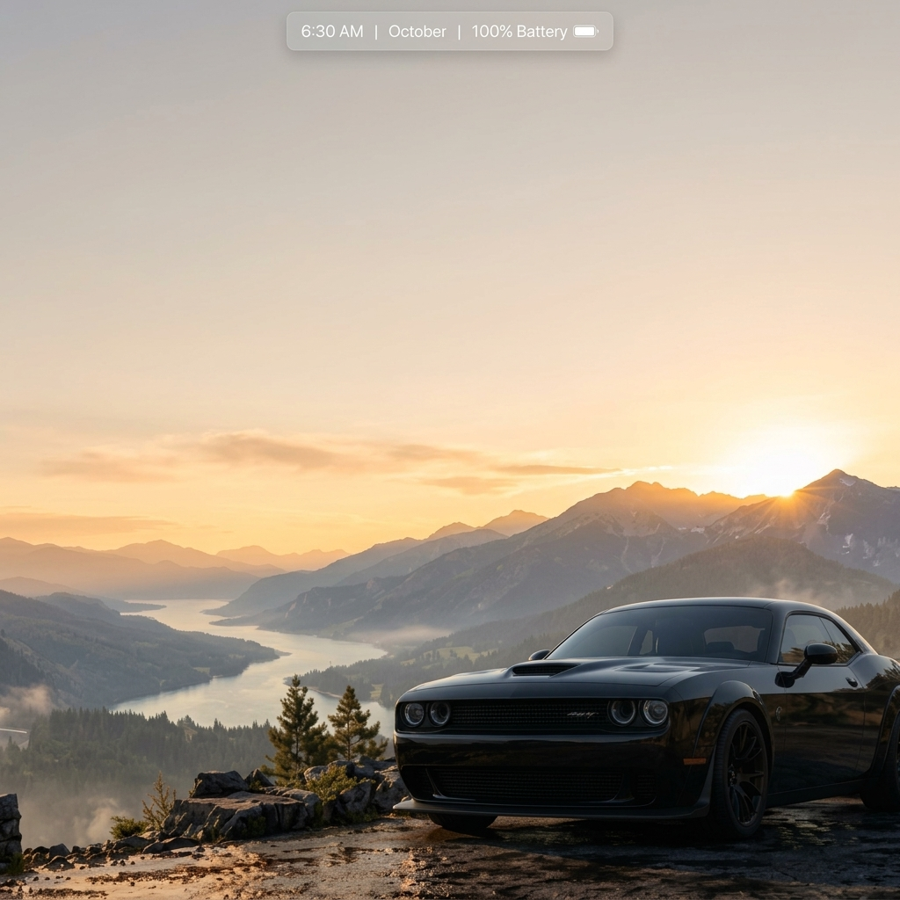
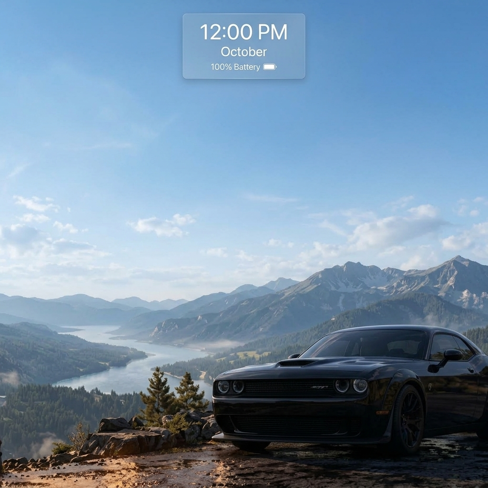
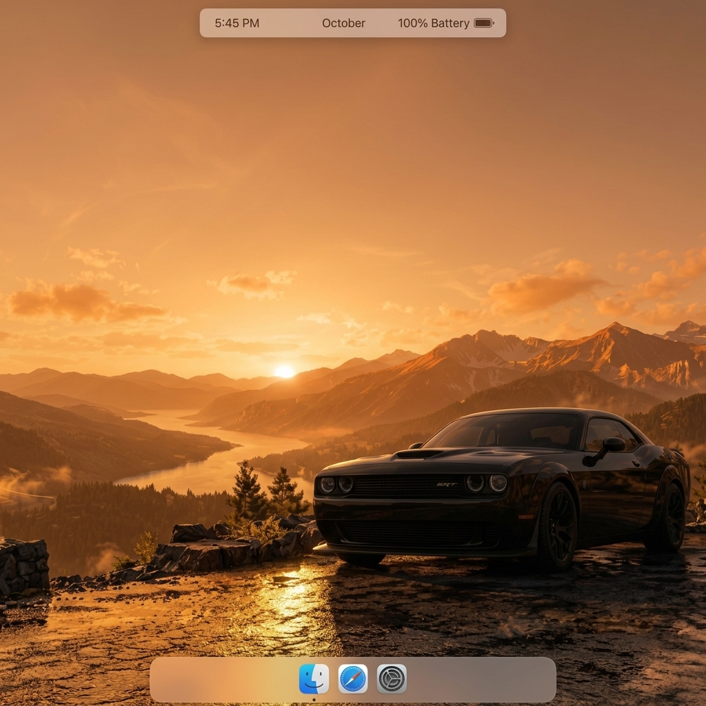
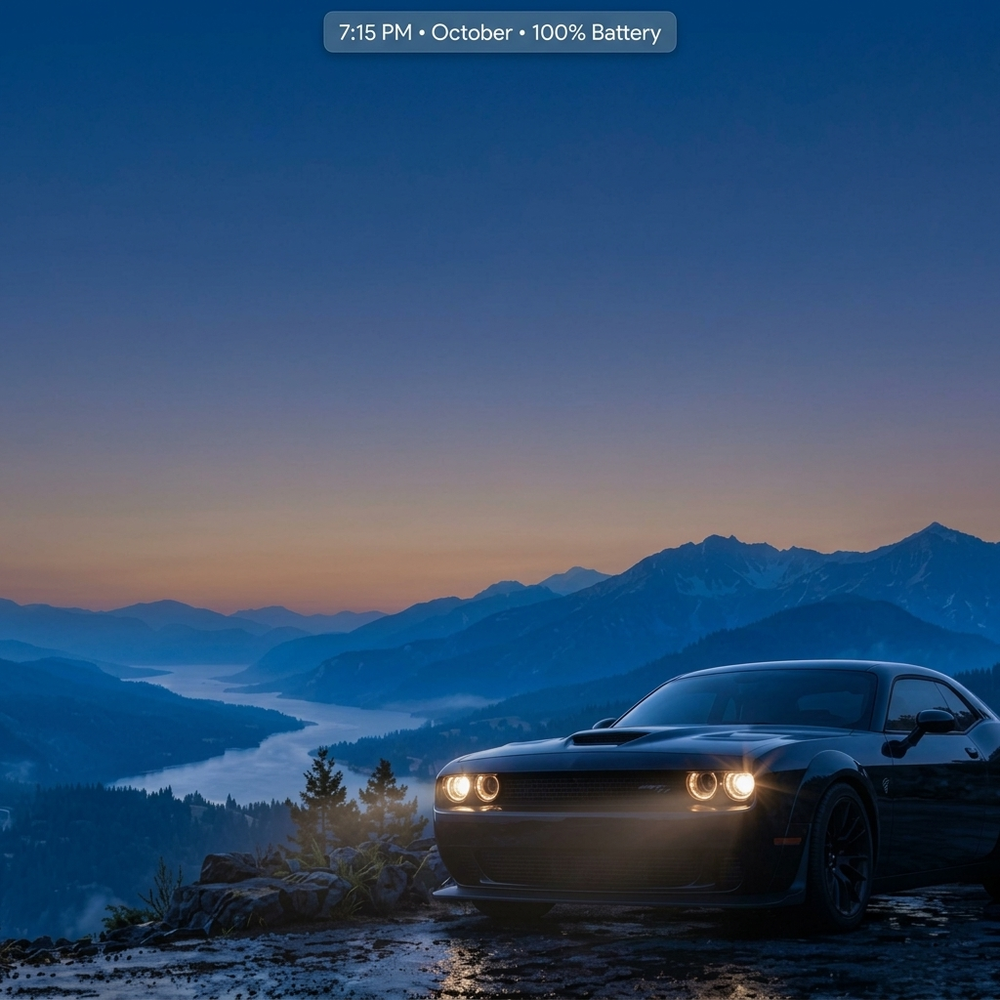
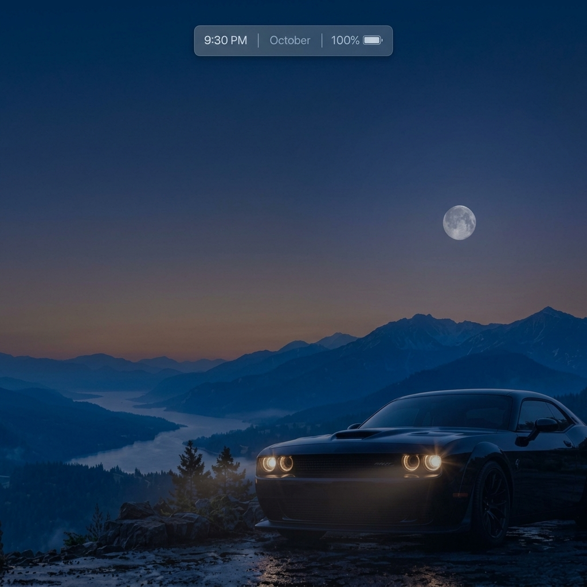
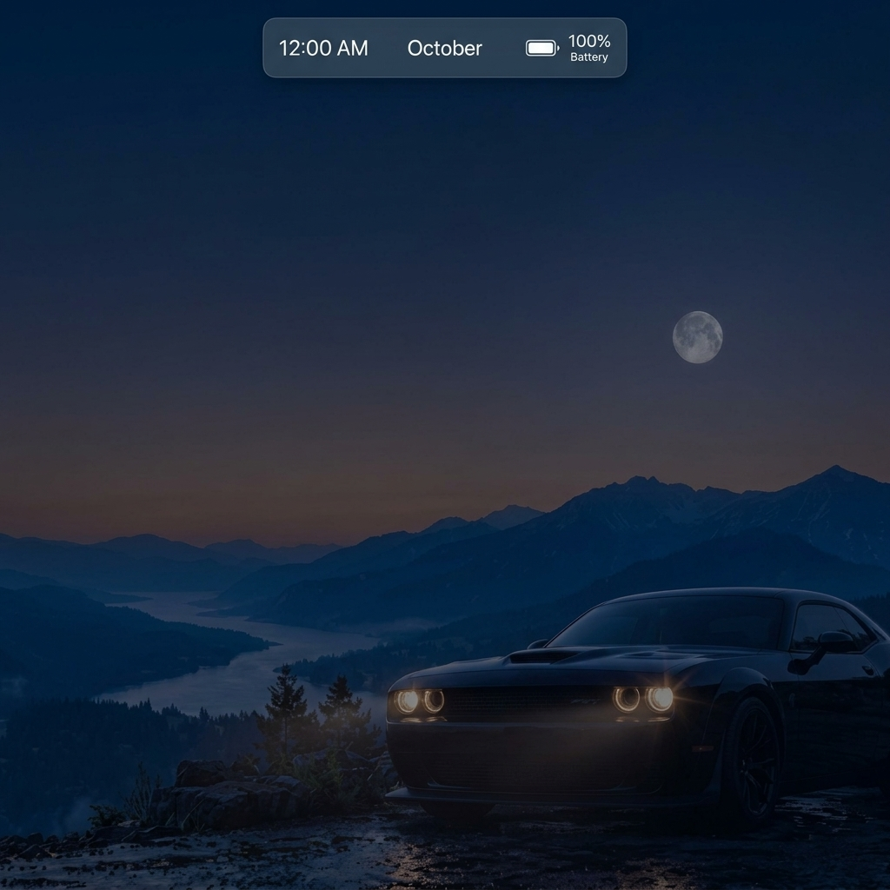

# NIGHTDRIVE

A cinematic, time-aware desktop wallpaper. A black muscle car on a winding mountain road
smoothly transforms through **sunrise → day → golden hour → dusk → night → midnight**
following your real local time, with a live HUD (clock, date, weather, battery) and quick
system controls.


| Morning | Day | Golden Hour |
|---|---|---|
|  |  |  |
| **Dusk** | **Night** | **Midnight** |
|  |  |  |

## Features

- **Reference-grade Wallpaper Stage & Unclipped Sky Clock**: six 1376×768 4:4:4 Cascade Overlook plates plus six 1376×768 Scenic Touring plates, 1:1 coordinate-locked headlight beams, feathered upper-right lunar composite, and a tall condensed translucent sky clock (`Oswald`) automatically clamped above every scene's measured ridge so silhouettes never cut clock digits.
- **Control Center Left Quick Settings Drawer**: zero-obstruction closed desktop (`6 px` invisible left hover trigger + `Ctrl/Cmd+B` + `Ctrl+Alt+N` on Windows), frosted translucent panel with Wi-Fi/Network & Bluetooth controls, audio slider + mute, Music card + scrubbing bar, Scene & Schedule card, Battery/Weather/Date/Time telemetry, Wallpaper Studio & Car Studio shortcuts, Display Settings, Restore Defaults, and Exit.
- **Editable Automatic Time Schedule**: dedicated 6-period local-time scheduler (`morning`, `day`, `goldenHour`, `dusk`, `night`, `midnight`) with editable `HH:MM` start times, configurable crossfade window (`1–45 min`), one-click period preview, manual scene lock with instant *Resume Automatic*, and Car Studio preservation across scenic transitions.
- **Wallpaper Studio**: searchable, filterable 12-scene local library (`Cascade Overlook` + `Scenic Touring`), favourites, local wallpaper import (`JPEG`/`PNG`/`WebP`, IndexedDB persistence), keyless **Wikimedia Commons** photographic search with inline photographer/license attribution, and optional **Unsplash** / **Pexels** API key support.
- **Car Studio**: searchable vehicle studio (`Integrated Challenger`, `Obsidian Muscle Coupe`, `Stealth GT Fastback`, `Phantom Apex Supercar`, plus transparent `PNG`/`WebP` local car import with real `<canvas>` alpha inspection) that composites vehicles onto car-free scenic plates with dynamic volumetric headlight cones and never stacks two cars.
- **Compact Music Bar & Windows SMTC Bridge**: taskbar-safe bottom dock and drawer player connected to Windows 10/11 `GlobalSystemMediaTransportControlsSessionManager` (Spotify, Apple Music, browsers, VLC) and/or a local audio file, with truthful idle state when no session is active.
- **Live Telemetry**: real battery percentage/charging state (graceful `Unavailable` fallback where unsupported) and real Open-Meteo weather with automatic location or city search (`°C`/`°F`), never fabricated demo numbers.

## Quick start (any device, in a browser)

```bash
git clone https://github.com/nitinsingla256-collab/NIGHTDRIVE.git
cd NIGHTDRIVE
npm start            # serves engine/ at http://localhost:8080
```

No Node? Any static server works, e.g. `python3 -m http.server 8080 -d engine`.
Open it fullscreen (F11) for the full wallpaper experience.

## Run as a desktop wallpaper

| Platform | Host | How |
|---|---|---|
| **Windows 10/11** | Native WebView2 host ([`hosts/windows/`](hosts/windows/)) | Download `NIGHTDRIVE-Windows-Host.zip` from [Releases](../../releases), or build it with `dotnet publish hosts/windows/NightdriveHost/NightdriveHost.csproj -c Release -r win-x64` (needs the [.NET 8 SDK](https://dotnet.microsoft.com/download/dotnet/8.0)) |
| **Windows 10/11** | [Lively Wallpaper](https://www.rocksdanister.com/lively/) | *Add Wallpaper* → choose `engine/index.html` |
| **Windows / macOS / Linux** | Tauri app ([`src-tauri/`](src-tauri/)) | `npm install && npm run tauri:build` (needs [Rust + Tauri prerequisites](https://tauri.app/v1/guides/getting-started/prerequisites)) |
| **macOS** | Native Swift host ([`hosts/macos/`](hosts/macos/)) | `python3 hosts/macos/build_macos.py` → `open hosts/macos/NIGHTDRIVE.app` (renders behind desktop icons on all monitors) |
| **Linux (X11)** | PyQt host ([`hosts/linux/`](hosts/linux/)) | `bash hosts/linux/install-linux.sh` (installs deps, menu entry and autostart) |

### What each feature needs

| Feature | Browser / Lively | Windows host | macOS host | Linux host |
|---|---|---|---|---|
| Scenes, clock | ✅ | ✅ | ✅ | ✅ |
| Weather | ✅ (location permission or IP fallback) | ✅ | ✅ | ✅ |
| Battery | Chromium browsers only | ✅ | Chromium-only API* | ✅ (psutil) |
| Settings buttons | Windows only | ✅ | ✅ | indicator only |

\* Safari/WebKit doesn't expose battery info, so the widget shows *N/A*.

## Project structure

```
NIGHTDRIVE/
├── engine/                 # The wallpaper itself (shared by every host)
│   ├── index.html
│   ├── script.js           # time engine, HUD, weather, battery, controls
│   ├── styles.css          # layout, responsive & accessibility rules
│   ├── engine-start.wav    # ignition sound played with the startup sequence
│   ├── sw.js               # service worker — offline cache of the engine
│   └── assets/             # per-period scenes + headlight overlays (see assets/README.md)
│                           #   landscape / portrait / car-layer / focus slots per period
├── hosts/
│   ├── windows/            # .NET 8 WPF + WebView2 host (desktop layer, tray, battery, Wi-Fi/BT)
│   ├── linux/              # PyQt5 X11 desktop host + installer
│   └── macos/              # Swift/WKWebView desktop-level host + build script
├── src-tauri/              # Cross-platform Tauri v1 host
├── scripts/                # serve.mjs (dev server), validate.mjs + smoke.mjs (tests),
│                           # rebuild-assets.py / build-headlights.py / preview-render.py (asset tooling)
│                           # asset-grades.json (fitted night/midnight grade)
├── docs/screenshots/       # README gallery (predates the 1.4.0 visual pass)
├── docs/preview/           # compositing previews from scripts/preview-render.py
└── .github/workflows/ci.yml
```

## Customising

- **Times and transitions**: edit `PERIODS` at the top of [`engine/script.js`](engine/script.js).
- **Images**: replace files in `engine/assets/<period>/`. See [`engine/assets/README.md`](engine/assets/README.md).
- **Startup sound**: drop an audio file into `engine/` and set `src` on the `<audio id="engine-audio">` tag.
- **Offline cache**: when you change any engine file, bump `CACHE_NAME` in [`engine/sw.js`](engine/sw.js) (e.g. `nightdrive-v1.4.1`) so clients pick up the new version.

## Development

```bash
npm test     # validates engine files, asset paths, host configs, scene-image
             # quality, and actually boots the engine in a DOM stub (runs in CI)
npm start    # local preview

python3 scripts/preview-render.py   # re-render docs/preview/ from the plates
```

See [CHANGELOG.md](CHANGELOG.md) for release notes.

## License

[MIT](LICENSE) © 2026 Nitin Singla
